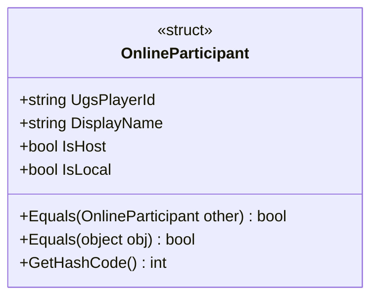

# OnlineParticipant

> One member of the online session as listed by Sessions (host first, then by join order).

**Módulo:** [[Modulo Core|Core]] · **Namespace:** `AlienFarms.Core` · **Archivo:** `Assets/Scripts/Core/OnlineParticipant.cs`

## Hereda / implementa
`IEquatable`

## Diagrama

## Usado por
[[DevConnectionPanel]], [[OnlineMenuController]], [[OnlineSessionChannel]], [[OnlineSessionService]], [[PlayerStatsSync]], [[RivalRules]], [[SessionExit]], [[Status]]
