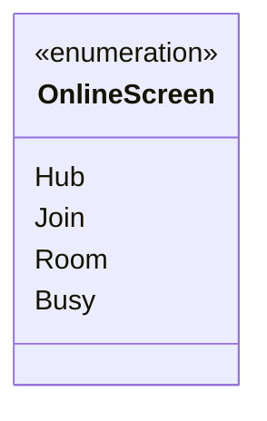

# OnlineScreen

> Screens of the online menu panel (resolved by AlienFarms.Menu.OnlineMenuRules.Resolve).

**Módulo:** [[Modulo Core|Core]] · **Namespace:** `AlienFarms.Core` · **Archivo:** `Assets/Scripts/Core/OnlineScreen.cs`

## Diagrama

## Valores
`Hub`, `Join`, `Room`, `Busy`

## Usado por
[[OnlineMenuController]], [[OnlineMenuRules]], [[OnlinePanelView]]
