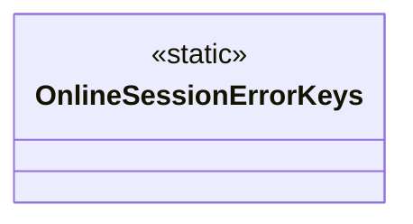

# OnlineSessionErrorKeys

> Localization keys (UI table) of the errors the online session reports through the session channel. The only error strings the online flow produces; the UI maps them to text. Null / empty means "no error".

**Módulo:** [[Modulo Core|Core]] · **Namespace:** `AlienFarms.Core` · **Archivo:** `Assets/Scripts/Core/OnlineSessionErrorKeys.cs`

## Diagrama

## Usado por
[[LobbyRules]], [[LocalizationKeys]], [[NetworkLobbyState]], [[OnlineLobbyChannel]], [[OnlineMenuController]], [[OnlineSessionChannel]], [[OnlineSessionCueRules]], [[OnlineSessionErrorMapper]], [[OnlineSessionService]], [[RejoinOfferRules]], [[RelaySessionConnection]], [[SessionExit]], [[UgsBootstrapper]]
