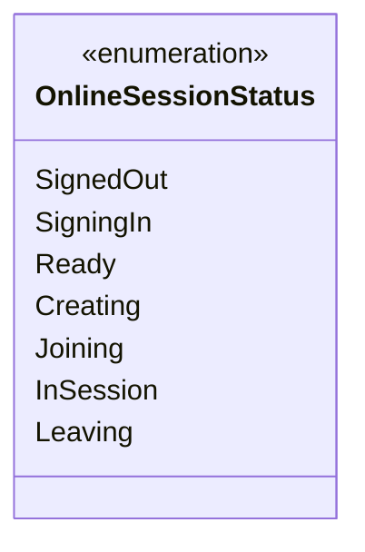

# OnlineSessionStatus

> Lifecycle of the online session as seen by this machine (see `OnlineSessionStatusRules`).

**Módulo:** [[Modulo Core|Core]] · **Namespace:** `AlienFarms.Core` · **Archivo:** `Assets/Scripts/Core/OnlineSessionStatus.cs`

## Diagrama

## Valores
`SignedOut`, `SigningIn`, `Ready`, `Creating`, `Joining`, `InSession`, `Leaving`

## Usado por
[[DevConnectionPanel]], [[LobbyStateSpawner]], [[MenuFlowController]], [[OnlineMenuController]], [[OnlineMenuRules]], [[OnlineModeRules]], [[OnlineSessionChannel]], [[OnlineSessionCueRules]], [[OnlineSessionService]], [[OnlineSessionSfxPlayer]], [[OnlineSessionStatusRules]], [[PlayerStatsSync]], [[RejoinOfferRules]], [[SessionExit]], [[Status]]
