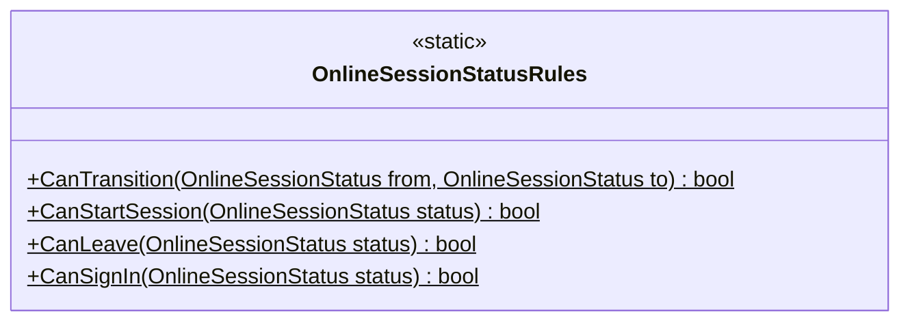

# OnlineSessionStatusRules

> Allowed transitions of `OnlineSessionStatus`. Pure, so the session channel and its tests share them. Any status may fall back to `OnlineSessionStatus.SignedOut` (services reset or root torn down).

**Módulo:** [[Modulo Core|Core]] · **Namespace:** `AlienFarms.Core` · **Archivo:** `Assets/Scripts/Core/OnlineSessionStatusRules.cs`

## Diagrama

## Usa
[[OnlineSessionStatus]]

## Usado por
[[OnlineMenuController]], [[OnlineSessionChannel]]
