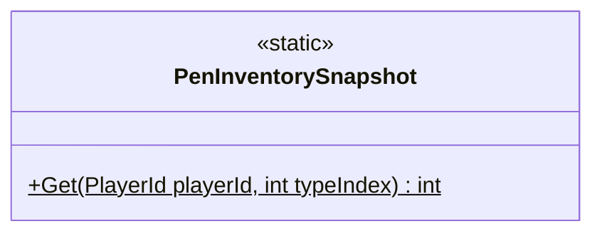

# PenInventorySnapshot

> Last pen inventory count raised per player and animal type, so a view enabled late (or re-enabled) can catch up without waiting for the next `GameEvents.OnPenInventoryChanged`. Written only by `GameEvents.RaisePenInventoryChanged` and cleared with the rest of the game event statics.

**Módulo:** [[Modulo Core|Core]] · **Namespace:** `AlienFarms.Core` · **Archivo:** `Assets/Scripts/Core/PenInventorySnapshot.cs`

## Diagrama

## Usa
[[PlayerId]]

## Usado por
[[GameEvents]], [[OnlineMatchStatsRecorder]], [[PenInventoryView]]
