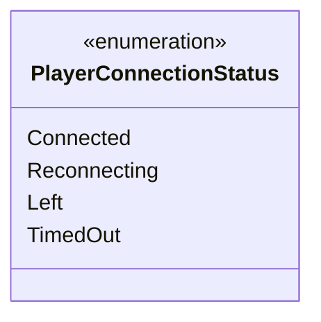

# PlayerConnectionStatus

> Online presence of a player seat (byte-sized: it is replicated in the seat presence board).

**Módulo:** [[Modulo Core|Core]] · **Namespace:** `AlienFarms.Core` · **Archivo:** `Assets/Scripts/Core/PlayerConnectionStatus.cs`

## Hereda / implementa
`byte`

## Diagrama

## Valores
`Connected`, `Reconnecting`, `Left`, `TimedOut`

## Usado por
[[ConnectionApprovalHandler]], [[ConnectionStatusRules]], [[ConnectionStatusView]], [[GameEvents]], [[MatchConnectionCueTracker]], [[MatchStatusSfxPlayer]], [[PresenceChange]], [[ReconnectGraceCoordinator]], [[ReconnectGraceRules]], [[ResultsMenuController]], [[SeatPresence]], [[SeatPresenceRules]]
