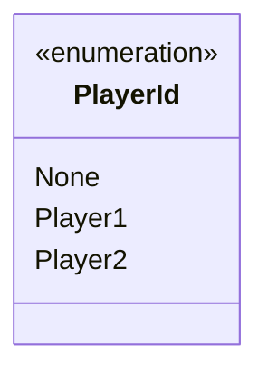

# PlayerId

> Identifies one of the two local players.

**Módulo:** [[Modulo Core|Core]] · **Namespace:** `AlienFarms.Core` · **Archivo:** `Assets/Scripts/Core/PlayerId.cs`

## Diagrama

## Valores
`None`, `Player1`, `Player2`

## Usado por
[[Animal]], [[AnimalSfxPlayer]], [[Bomb]], [[BombBlastRules]], [[BombBlastVfxPlayer]], [[BombSfxPlayer]], [[CaptureRules]], [[CharacterCardView]], [[CharacterSelectView]], [[CharacterSelection]], [[ConnectionApprovalHandler]], [[GameEvents]], [[IGrabbable]], [[IPlayerRigLookup]], [[IStunnable]], [[IZoneResolver]], [[JoinPromptView]], [[LocalPlayerRigLookup]], [[MatchManager]], [[MatchResult]], [[MatchResultsView]], [[MatchScore]], [[MatchSession]], [[MatchState]], [[MatchStateMachine]], [[MenuFlowController]], [[MenuLobby]], [[NetworkPlayer]], [[NetworkPlayerRoster]], [[PauseController]], [[PauseHoldIndicatorView]], [[PauseMenuView]], [[PlayerCharacterCache]], [[PlayerGrabber]], [[PlayerHudThemeView]], [[PlayerIdExtensions]], [[PlayerIdentity]], [[PlayerJoinCoordinator]], [[PlayerMenuInput]], [[PlayerMenuRouter]], [[PlayerRig]], [[PlayerSlot]], [[PlayerSlotStatusView]], [[PlayerStunReceiver]], [[PlayerTackle]], [[PlayerZone]], [[PlayerZoneRegistry]], [[ResultsMenuController]], [[ResultsState]], [[ScoreView]], [[ServerSlotDirectory]], [[SessionData]], [[SessionSlot]]
