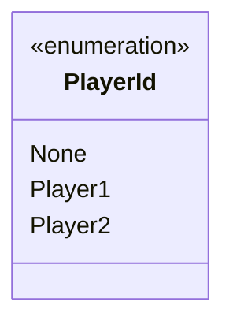

# PlayerId

> Identifies one of the two local players.

**Módulo:** [[Modulo Core|Core]] · **Namespace:** `AlienFarms.Core` · **Archivo:** `Assets/Scripts/Core/PlayerId.cs`

## Diagrama

## Valores
`None`, `Player1`, `Player2`

## Usado por
[[Animal]], [[AnimalNetState]], [[AnimalSfxPlayer]], [[ApprovalDecision]], [[ApprovalRules]], [[Bomb]], [[BombBlastRules]], [[BombBlastVfxPlayer]], [[BombNetState]], [[BombSfxPlayer]], [[CaptureRules]], [[CarriableOwner]], [[CarriableOwnerRules]], [[CharacterCardView]], [[CharacterSelectSfxPlayer]], [[CharacterSelectView]], [[CharacterSelection]], [[ConnectionApprovalHandler]], [[ConnectionStatusView]], [[GameEvents]], [[IGrabbable]], [[IMatchContext]], [[IPlayerRigLookup]], [[IStunnable]], [[IZoneResolver]], [[JoinPromptView]], [[LobbyRules]], [[LobbySlotEntry]], [[LocalPlayerRigLookup]], [[MatchConnectionCueTracker]], [[MatchManager]], [[MatchResult]], [[MatchResultRules]], [[MatchResultsView]], [[MatchScore]], [[MatchSession]], [[MatchState]], [[MatchStateMachine]], [[MatchStatsTally]], [[MatchStatusSfxPlayer]], [[MenuFlowController]], [[MenuLobby]], [[NameTagRules]], [[NetworkAnimal]], [[NetworkBomb]], [[NetworkCarriable]], [[NetworkLobbyState]], [[NetworkMatchExit]], [[NetworkMatchState]], [[NetworkNameTag]], [[NetworkPenLedger]], [[NetworkPlayer]], [[NetworkPlayerRoster]], [[NetworkRuntimeAnchor]], [[OnlineLobbyChannel]], [[OnlineLobbyCueRules]], [[OnlineLobbySeat]], [[OnlineLobbySnapshot]], [[OnlineMatchStatsRecorder]], [[OnlineMenuController]], [[OnlinePanelView]], [[OnlineSeatView]], [[OnlineSessionService]], [[PauseController]], [[PauseHoldIndicatorView]], [[PauseMenuView]], [[PenInventorySnapshot]], [[PenInventoryView]], [[PlayerCharacterCache]], [[PlayerGrabber]], [[PlayerHudThemeView]], [[PlayerIdExtensions]], [[PlayerIdentity]], [[PlayerJoinCoordinator]], [[PlayerMenuInput]], [[PlayerMenuRouter]], [[PlayerRig]], [[PlayerSlot]], [[PlayerSlotStatusView]], [[PlayerStatsRules]], [[PlayerStunReceiver]], [[PlayerTackle]], [[PlayerZone]], [[PlayerZoneRegistry]], [[PlayingState]], [[PresenceChange]], [[ReconnectGraceCoordinator]], [[ResultsMenuController]], [[ResultsState]], [[ScoreBoard]], [[ScoreView]], [[SeatGraceRules]], [[SeatPresenceBoard]], [[SeatPresenceRules]], [[ServerSlotDirectory]], [[SessionData]], [[SessionExit]], [[SessionSlot]], [[UgsBootstrapper]]
