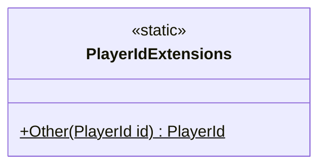

# PlayerIdExtensions

> Helpers for the two-player `PlayerId`.

**Módulo:** [[Modulo Core|Core]] · **Namespace:** `AlienFarms.Core` · **Archivo:** `Assets/Scripts/Core/PlayerIdExtensions.cs`

## Diagrama

## Usa
[[PlayerId]]
