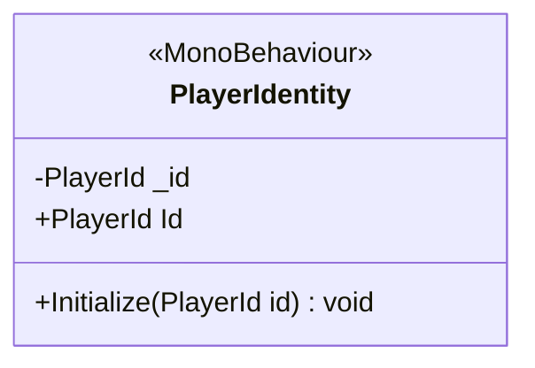

# PlayerIdentity

> Holds which local player owns this GameObject hierarchy.

**Módulo:** [[Modulo Core|Core]] · **Namespace:** `AlienFarms.Core` · **Archivo:** `Assets/Scripts/Core/PlayerIdentity.cs`

## Hereda / implementa
`MonoBehaviour`

## Diagrama

## Usa
[[PlayerId]]

## Usado por
[[Bomb]], [[MenuLobby]], [[NetworkPlayer]], [[PlayerGrabber]], [[PlayerMenuInput]], [[PlayerPauseInput]], [[PlayerRig]], [[PlayerStunReceiver]], [[PlayerTackle]]
