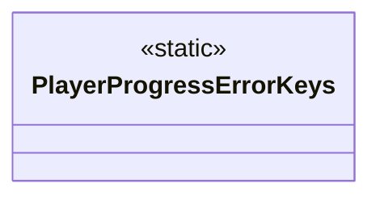

# PlayerProgressErrorKeys

> Localization keys (UI table) of the persistent progress (cloud stats) errors the cloud save service reports through the PlayerProgressChannel. Null / empty means "no error".

**Módulo:** [[Modulo Core|Core]] · **Namespace:** `AlienFarms.Core` · **Archivo:** `Assets/Scripts/Core/PlayerProgressErrorKeys.cs`

## Diagrama

## Usado por
[[CloudSaveErrorRules]], [[CloudSavePlayerStatsStore]], [[LocalizationKeys]], [[PlayerStatsLedger]], [[PlayerStatsSync]], [[SimulatedFailureStatsStore]], [[StatsStoreResult]]
