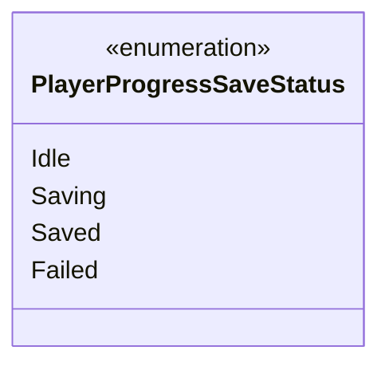

# PlayerProgressSaveStatus

> State of the last write of the player's persistent progress.

**Módulo:** [[Modulo Core|Core]] · **Namespace:** `AlienFarms.Core` · **Archivo:** `Assets/Scripts/Core/PlayerProgressSaveStatus.cs`

## Diagrama

## Valores
`Idle`, `Saving`, `Saved`, `Failed`

## Usado por
[[PlayerProgressChannel]], [[PlayerStatsSync]], [[SaveStatusBadgeView]], [[TitleStatsView]]
