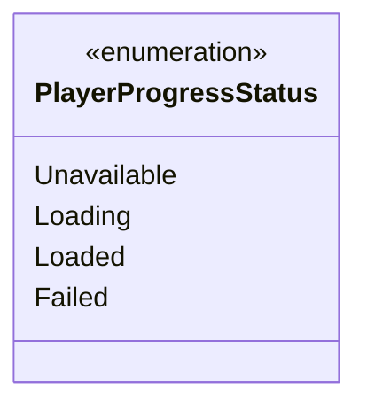

# PlayerProgressStatus

> Load state of the player's persistent progress (cloud stats).

**Módulo:** [[Modulo Core|Core]] · **Namespace:** `AlienFarms.Core` · **Archivo:** `Assets/Scripts/Core/PlayerProgressStatus.cs`

## Diagrama

## Valores
`Unavailable`, `Loading`, `Loaded`, `Failed`

## Usado por
[[PlayerProgressChannel]]
