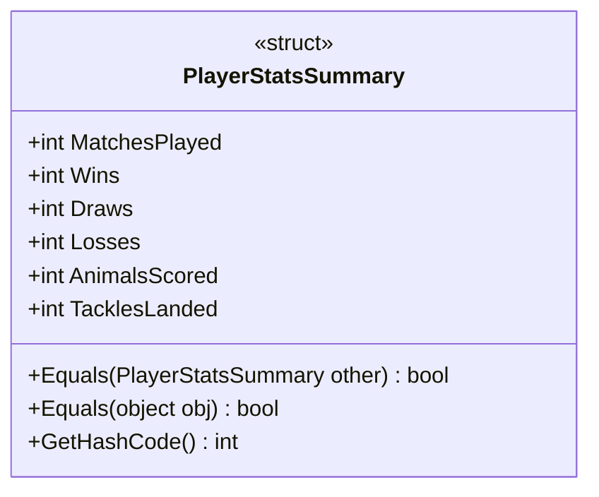

# PlayerStatsSummary

> Lifetime stats of the local player shown on the title screen.

**Módulo:** [[Modulo Core|Core]] · **Namespace:** `AlienFarms.Core` · **Archivo:** `Assets/Scripts/Core/PlayerStatsSummary.cs`

## Hereda / implementa
`IEquatable`

## Diagrama

## Usado por
[[MatchStatsTally]], [[OnlineMatchStatsRecorder]], [[PendingStats]], [[PendingStatsCodec]], [[PlayerProgressChannel]], [[PlayerStatsCodec]], [[PlayerStatsLedger]], [[PlayerStatsRecord]], [[PlayerStatsRules]], [[PlayerStatsSync]], [[RivalStatsView]], [[TitleStatsView]]
