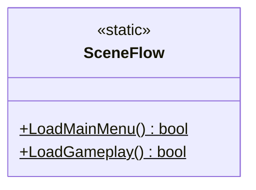

# SceneFlow

> Stateless scene transitions. Every load restores time and audio first, so leaving a paused scene never carries `Time.timeScale` = 0 or a paused `AudioListener` into the next one.

**Módulo:** [[Modulo Core|Core]] · **Namespace:** `AlienFarms.Core` · **Archivo:** `Assets/Scripts/Core/SceneFlow.cs`

## Diagrama

## Usa
[[SceneNames]]

## Usado por
[[DevConnectionPanel]], [[LocalMatchExitHandler]], [[MenuFlowController]], [[OnlineMatchBootstrap]], [[OnlineMatchExitHandler]], [[Status]]
