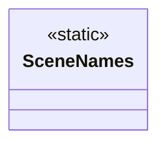

# SceneNames

> Scene names as listed in Build Settings (MainMenu = 0, Prototype = 1).

**Módulo:** [[Modulo Core|Core]] · **Namespace:** `AlienFarms.Core` · **Archivo:** `Assets/Scripts/Core/SceneNames.cs`

## Diagrama

## Usado por
[[SceneFlow]]
