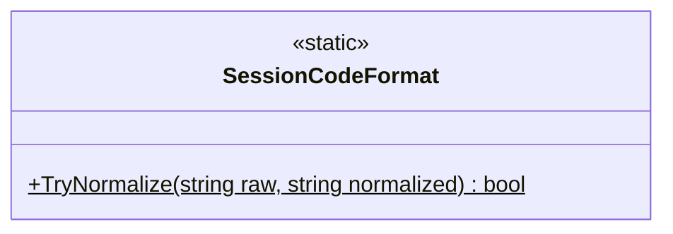

# SessionCodeFormat

> Local check of a typed session join code before calling the service: trims, upper-cases and accepts only the characters the service issues. Session codes are lobby codes; like Relay join codes (documented in com.unity.services.multiplayer, Relay JoinRequest) they are case-insensitive, 6 to 12 characters long and use only `Alphabet` (no vowels nor look-alike characters such as 0/O, 1/I, 5/S, Z).

**Módulo:** [[Modulo Core|Core]] · **Namespace:** `AlienFarms.Core` · **Archivo:** `Assets/Scripts/Core/SessionCodeFormat.cs`

## Diagrama

## Usado por
[[MembershipRules]], [[OnlineSessionChannel]]
