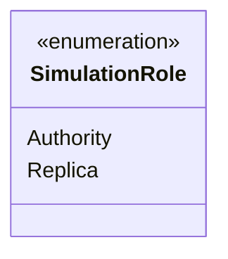

# SimulationRole

> Who runs a simulated component. Authority runs the gameplay logic (local mode and the online server); Replica only shows state applied from outside (online clients). Every target defaults to Authority.

**Módulo:** [[Modulo Core|Core]] · **Namespace:** `AlienFarms.Core` · **Archivo:** `Assets/Scripts/Core/SimulationRole.cs`

## Diagrama

## Valores
`Authority`, `Replica`

## Usado por
[[Animal]], [[AnimalSpawner]], [[AnimalTypePool]], [[Bomb]], [[BombSpawner]], [[ISimulationRoleTarget]], [[NetworkAnimal]], [[NetworkAnimalPoolHandler]], [[NetworkBomb]], [[NetworkBombPoolHandler]], [[NetworkPlayer]], [[ObstacleField]], [[OnlineMatchBootstrap]], [[PlayerGrabber]], [[PlayerMovement]], [[PlayerStunReceiver]]
