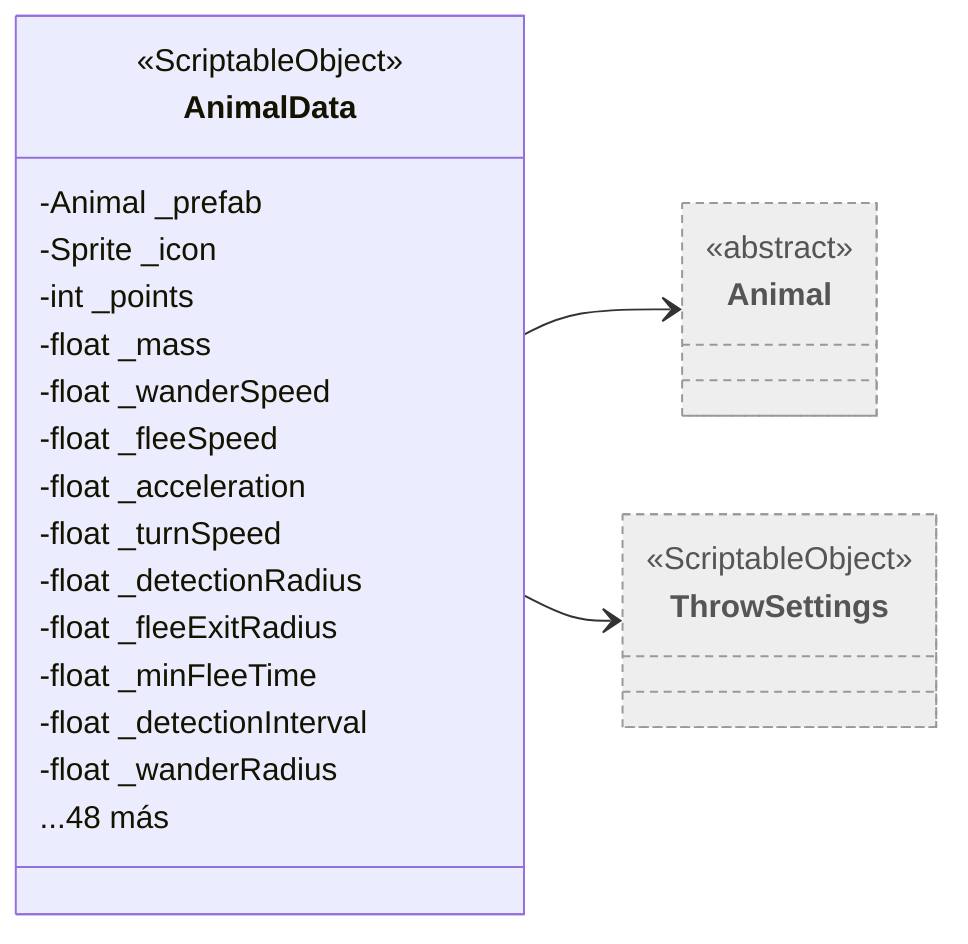

# AnimalData

> Tuning and prefab for one animal type.

**Módulo:** [[Modulo Data|Data]] · **Namespace:** `AlienFarms.Data` · **Archivo:** `Assets/Scripts/Data/AnimalData.cs`

## Hereda / implementa
`ScriptableObject`

## Derivados / implementaciones
[[ChickenData]]

## Diagrama

## Usa
[[Animal]], [[SoundCue]], [[ThrowSettings]]

## Usado por
[[Animal]], [[AnimalSfxPlayer]], [[AnimalSpawnEntry]], [[AnimalSpawner]], [[AnimalTypePool]], [[ChickenData]], [[MatchManager]], [[MatchScore]], [[NetworkAnimalPoolHandler]], [[NetworkSpawnRegistry]]
