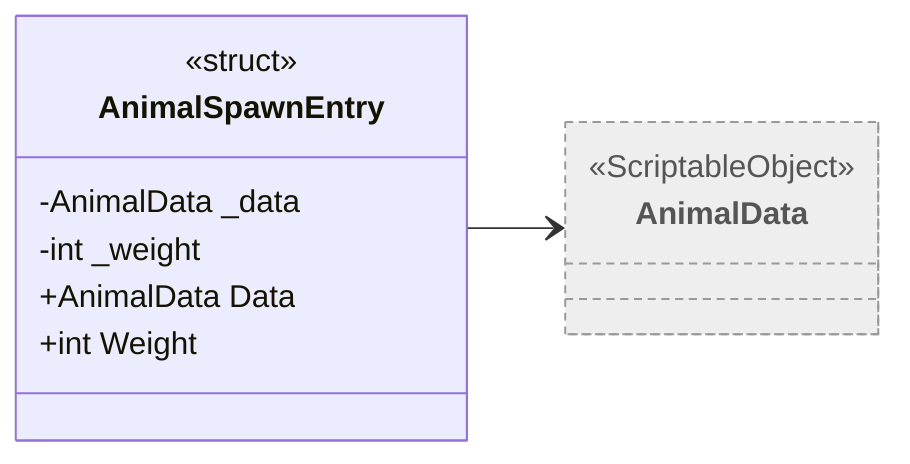

# AnimalSpawnEntry

> One weighted animal type in `AnimalSpawnSettings`.

**Módulo:** [[Modulo Data|Data]] · **Namespace:** `AlienFarms.Data` · **Archivo:** `Assets/Scripts/Data/AnimalSpawnEntry.cs`

## Diagrama

## Usa
[[AnimalData]]

## Usado por
[[AnimalSpawnSettings]], [[AnimalSpawner]]
