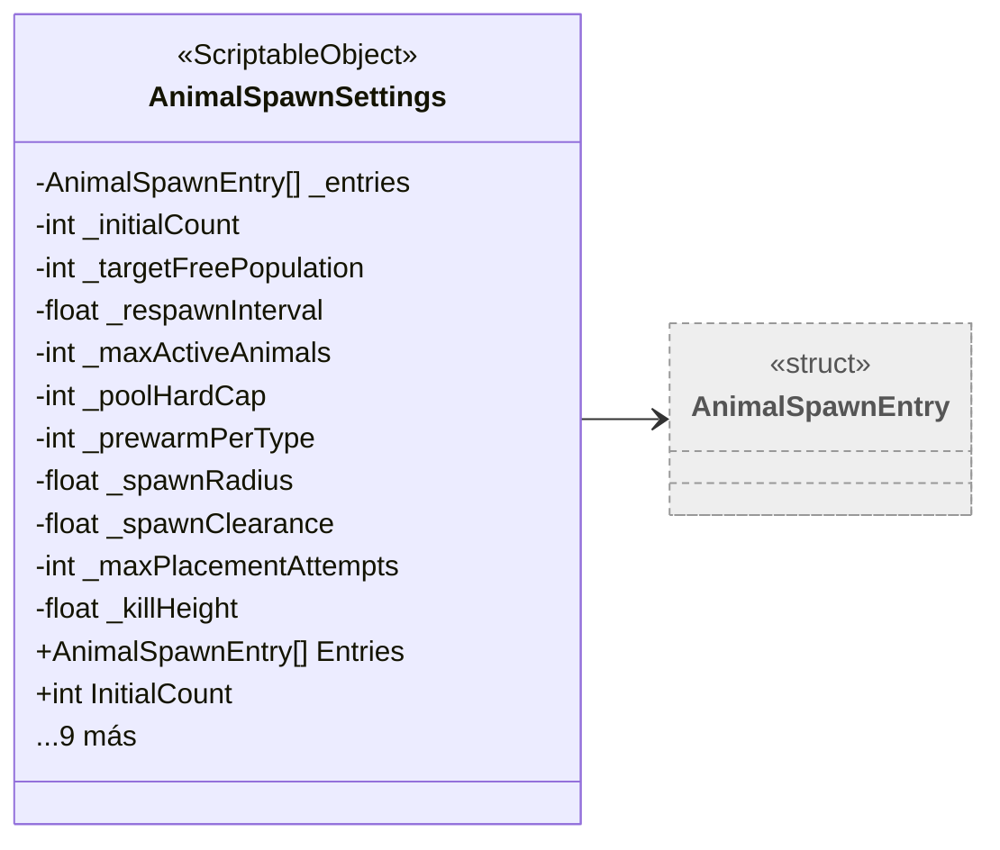

# AnimalSpawnSettings

> Population and placement rules for the animal spawner.

**Módulo:** [[Modulo Data|Data]] · **Namespace:** `AlienFarms.Data` · **Archivo:** `Assets/Scripts/Data/AnimalSpawnSettings.cs`

## Hereda / implementa
`ScriptableObject`

## Diagrama

## Usa
[[AnimalSpawnEntry]]

## Usado por
[[AnimalSpawner]]
