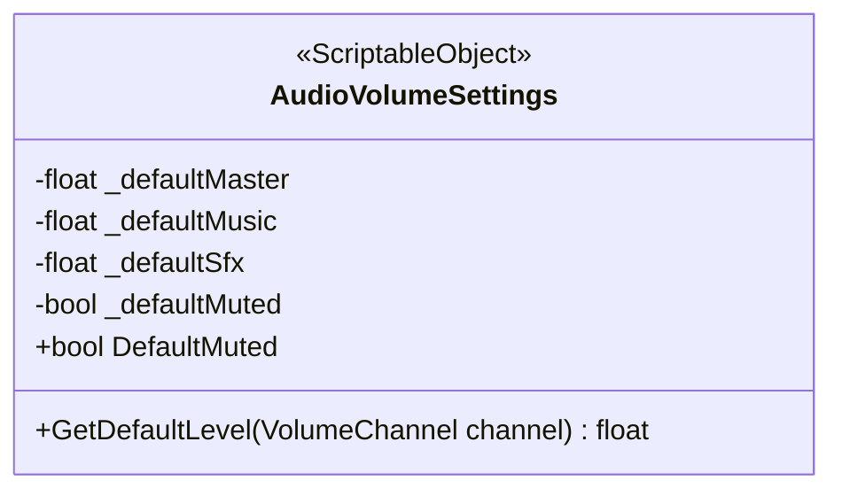

# AudioVolumeSettings

> Default volume levels used until the player changes them (saved choices live in PlayerPrefs).

**Módulo:** [[Modulo Data|Data]] · **Namespace:** `AlienFarms.Data` · **Archivo:** `Assets/Scripts/Data/AudioVolumeSettings.cs`

## Hereda / implementa
`ScriptableObject`

## Diagrama

## Usa
[[VolumeChannel]]

## Usado por
[[AudioVolumeService]], [[VolumeState]]
