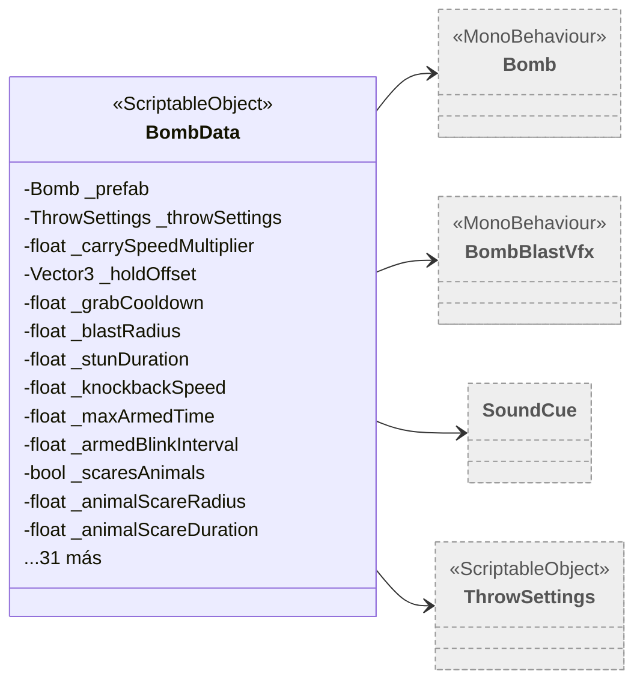

# BombData

> Definition of the stun bomb: prefab, carry/throw tuning, blast, VFX and sound effects.

**Módulo:** [[Modulo Data|Data]] · **Namespace:** `AlienFarms.Data` · **Archivo:** `Assets/Scripts/Data/BombData.cs`

## Hereda / implementa
`ScriptableObject`

## Diagrama

## Usa
[[Bomb]], [[BombBlastVfx]], [[SoundCue]], [[ThrowSettings]]

## Usado por
[[Bomb]], [[BombBlastVfxPlayer]], [[BombSfxPlayer]], [[BombSpawner]], [[NetworkSpawnRegistry]]
