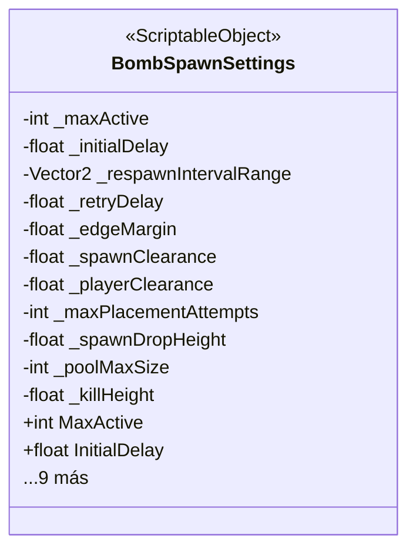

# BombSpawnSettings

> When and where stun bombs appear in the Animal Zone.

**Módulo:** [[Modulo Data|Data]] · **Namespace:** `AlienFarms.Data` · **Archivo:** `Assets/Scripts/Data/BombSpawnSettings.cs`

## Hereda / implementa
`ScriptableObject`

## Diagrama

## Usado por
[[BombSpawner]]
