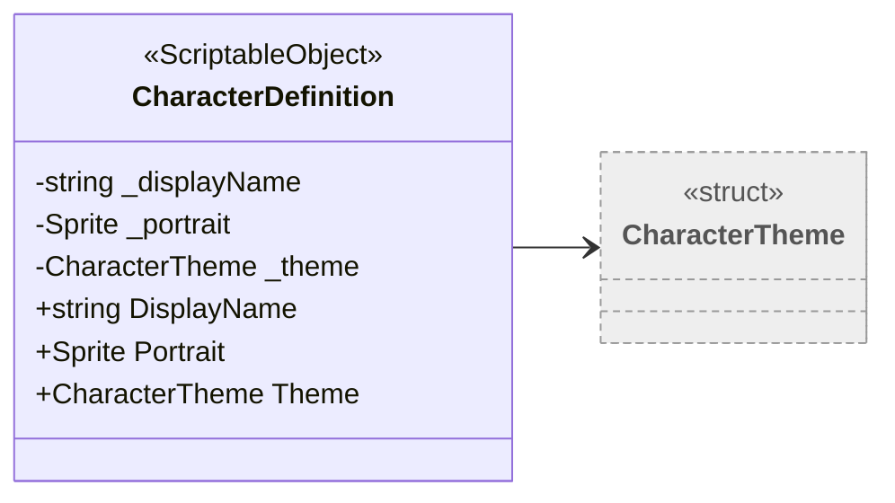

# CharacterDefinition

> A playable character: display name, optional portrait and color theme. The 3D visual is a pre-existing child of the Player prefab matched by this asset (see PlayerAppearance), so no prefab is referenced here.

**Módulo:** [[Modulo Data|Data]] · **Namespace:** `AlienFarms.Data` · **Archivo:** `Assets/Scripts/Data/CharacterDefinition.cs`

## Hereda / implementa
`ScriptableObject`

## Diagrama

## Usa
[[CharacterTheme]]

## Usado por
[[CharacterCardView]], [[CharacterRoster]], [[CharacterSelectView]], [[CharacterVisual]], [[GameEvents]], [[MatchResultsView]], [[MatchSession]], [[MenuFlowController]], [[NetworkPlayer]], [[NetworkPlayerRoster]], [[PauseMenuView]], [[PlayerAppearance]], [[PlayerCharacterCache]], [[PlayerHudThemeView]], [[PlayerJoinCoordinator]], [[PlayerRig]], [[PlayerSlotStatusView]], [[SessionSlot]]
