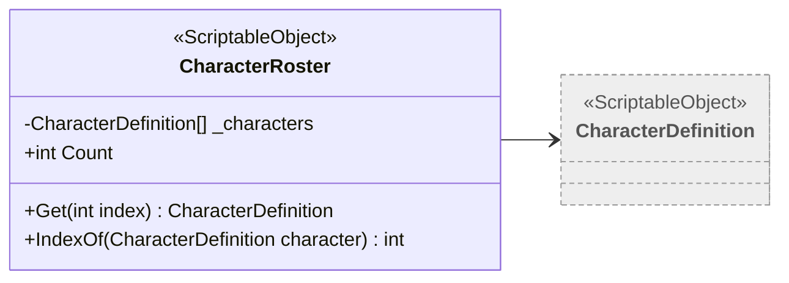

# CharacterRoster

> Ordered list of selectable characters (character select order).

**Módulo:** [[Modulo Data|Data]] · **Namespace:** `AlienFarms.Data` · **Archivo:** `Assets/Scripts/Data/CharacterRoster.cs`

## Hereda / implementa
`ScriptableObject`

## Diagrama

## Usa
[[CharacterDefinition]]

## Usado por
[[MenuFlowController]], [[NetworkLobbyState]], [[NetworkPlayer]], [[NetworkPlayerRoster]], [[OnlineMenuController]]
