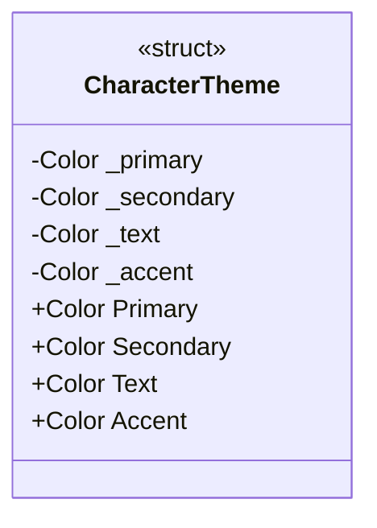

# CharacterTheme

> Colors that identify a playable character in the HUD and menus.

**Módulo:** [[Modulo Data|Data]] · **Namespace:** `AlienFarms.Data` · **Archivo:** `Assets/Scripts/Data/CharacterTheme.cs`

## Diagrama

## Usado por
[[CharacterDefinition]], [[PlayerHudThemeView]]
