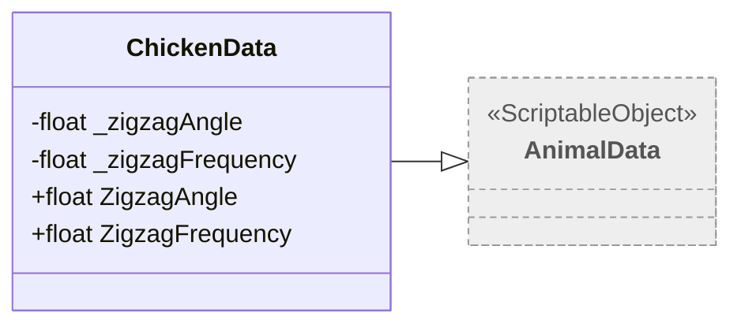

# ChickenData

> Animal data for chickens: adds a zigzag while fleeing.

**Módulo:** [[Modulo Data|Data]] · **Namespace:** `AlienFarms.Data` · **Archivo:** `Assets/Scripts/Data/ChickenData.cs`

## Hereda / implementa
[[AnimalData]]

## Diagrama

## Usa
[[AnimalData]]

## Usado por
[[Chicken]]
