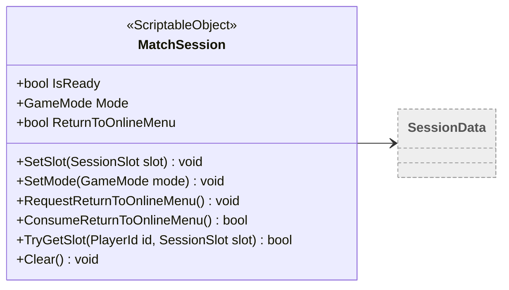

# MatchSession

> Runtime-only ScriptableObject that carries the players' choices (devices, scheme, character) from the MainMenu to the gameplay scene. Nothing is serialized: data written during a previous play session is discarded through a generation counter bumped on every play start (works without domain reload). Online, `Mode` is `GameMode.Online` (characters are picked in the online room, server side).

**Módulo:** [[Modulo Data|Data]] · **Namespace:** `AlienFarms.Data` · **Archivo:** `Assets/Scripts/Data/MatchSession.cs`

## Hereda / implementa
`ScriptableObject`

## Diagrama

## Usa
[[GameMode]], [[Mode]], [[PlayerId]], [[SessionData]], [[SessionSlot]]

## Usado por
[[DevConnectionPanel]], [[GameModeRouter]], [[JoinPromptView]], [[LocalMatchExitHandler]], [[MatchExit]], [[MenuFlowController]], [[OnlineMatchBootstrap]], [[OnlineMatchExitHandler]], [[OnlineSessionService]], [[PlayerJoinCoordinator]], [[SaveStatusBadgeView]], [[SessionExit]], [[Status]]
