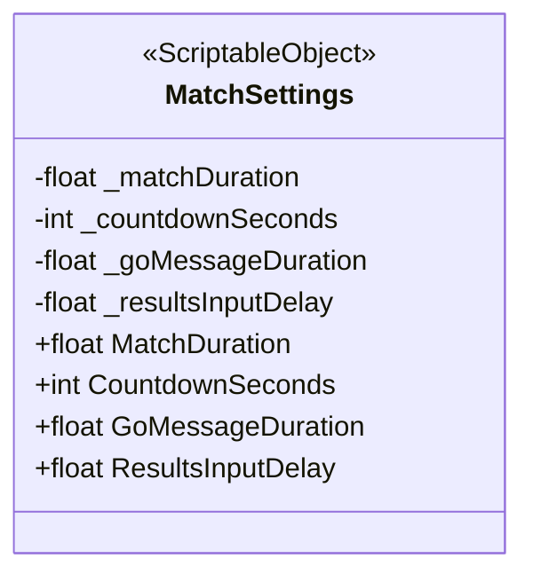

# MatchSettings

> Timing rules of a match round.

**Módulo:** [[Modulo Data|Data]] · **Namespace:** `AlienFarms.Data` · **Archivo:** `Assets/Scripts/Data/MatchSettings.cs`

## Hereda / implementa
`ScriptableObject`

## Diagrama

## Usado por
[[IMatchContext]], [[MatchManager]]
