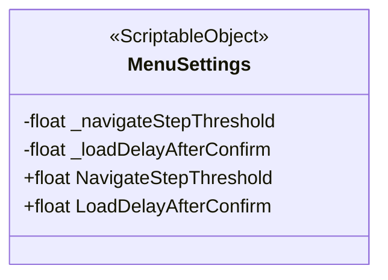

# MenuSettings

> Menu navigation tuning shared by per-player menu input.

**Módulo:** [[Modulo Data|Data]] · **Namespace:** `AlienFarms.Data` · **Archivo:** `Assets/Scripts/Data/MenuSettings.cs`

## Hereda / implementa
`ScriptableObject`

## Diagrama

## Usado por
[[MenuFlowController]], [[PlayerMenuInput]]
