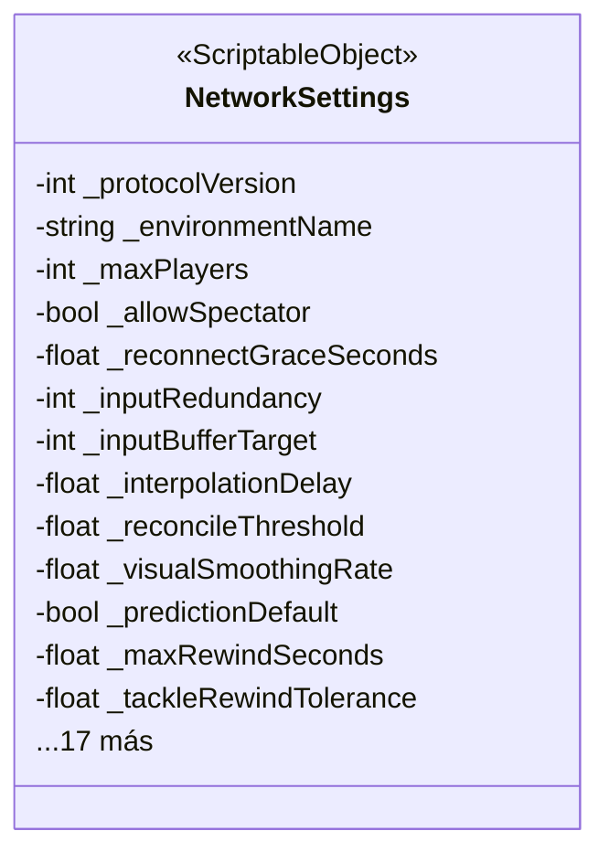

# NetworkSettings

> Tuning of the online mode (sessions, input, interpolation, prediction and lag compensation). Primitive fields only, so it lives in the runtime assembly and is read by the networking layer.

**Módulo:** [[Modulo Data|Data]] · **Namespace:** `AlienFarms.Data` · **Archivo:** `Assets/Scripts/Data/NetworkSettings.cs`

## Hereda / implementa
`ScriptableObject`

## Diagrama

