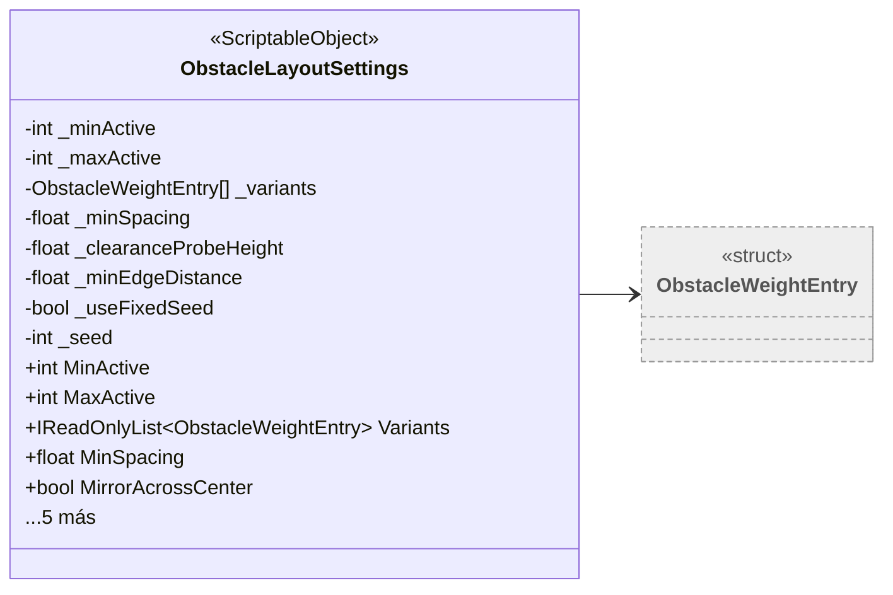

# ObstacleLayoutSettings

> Rules for the random obstacle layout of the Animal Zone (rolled every new round).

**Módulo:** [[Modulo Data|Data]] · **Namespace:** `AlienFarms.Data` · **Archivo:** `Assets/Scripts/Data/ObstacleLayoutSettings.cs`

## Hereda / implementa
`ScriptableObject`

## Diagrama

## Usa
[[ObstacleVariantData]], [[ObstacleWeightEntry]]

## Usado por
[[ObstacleField]]
