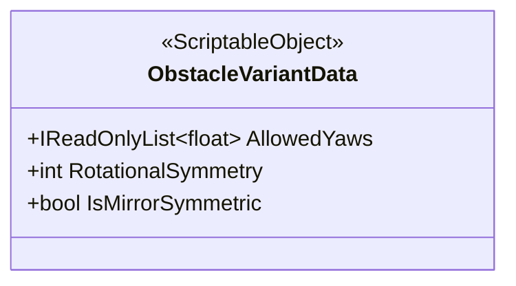

# ObstacleVariantData

> One obstacle type (fence, UFO disc...) and the yaws it may be placed with.

**Módulo:** [[Modulo Data|Data]] · **Namespace:** `AlienFarms.Data` · **Archivo:** `Assets/Scripts/Data/ObstacleVariantData.cs`

## Hereda / implementa
`ScriptableObject`

## Diagrama

## Usado por
[[ObstacleField]], [[ObstacleLayoutSettings]], [[ObstacleVariant]], [[ObstacleWeightEntry]]
