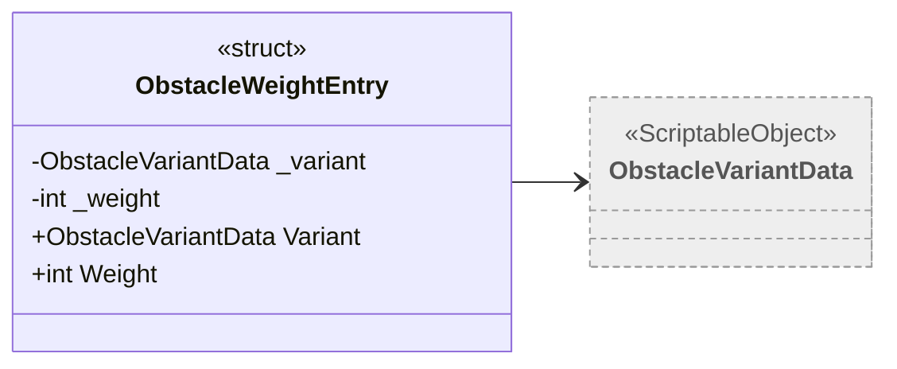

# ObstacleWeightEntry

> One weighted obstacle variant in `ObstacleLayoutSettings`.

**Módulo:** [[Modulo Data|Data]] · **Namespace:** `AlienFarms.Data` · **Archivo:** `Assets/Scripts/Data/ObstacleWeightEntry.cs`

## Diagrama

## Usa
[[ObstacleVariantData]]

## Usado por
[[ObstacleField]], [[ObstacleLayoutSettings]]
