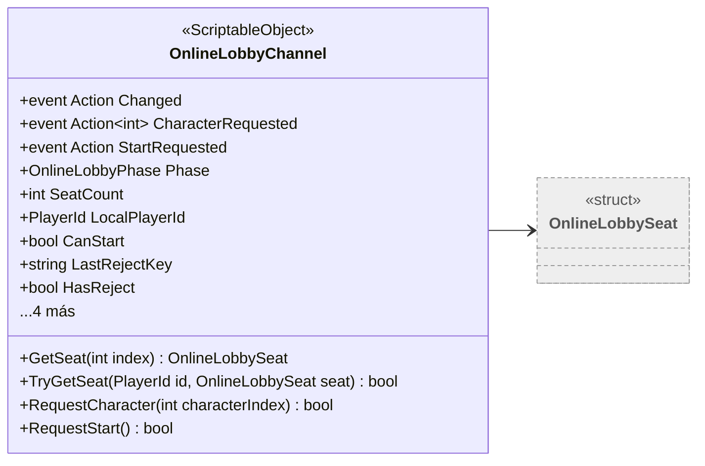

# OnlineLobbyChannel

> Runtime channel between the online room menu (requests, views) and the network lobby (state). The menu only calls the Request* methods and reads the state; the network lobby listens to the requests on every peer and is the only writer. Primitive data only, so the menu never references networking. Nothing is serialized: state from a previous play session is discarded through a generation counter.

**Módulo:** [[Modulo Data|Data]] · **Namespace:** `AlienFarms.Data` · **Archivo:** `Assets/Scripts/Data/OnlineLobbyChannel.cs`

## Hereda / implementa
`ScriptableObject`

## Diagrama

## Usa
[[OnlineLobbyPhase]], [[OnlineLobbySeat]], [[OnlineSessionErrorKeys]], [[Phase]], [[PlayerId]]

## Usado por
[[DevConnectionPanel]], [[LobbyStateSpawner]], [[NetworkLobbyState]], [[OnlineLobbySnapshot]], [[OnlineMenuController]], [[OnlineMenuRules]], [[OnlinePanelView]], [[OnlineSessionSfxPlayer]], [[Status]]
