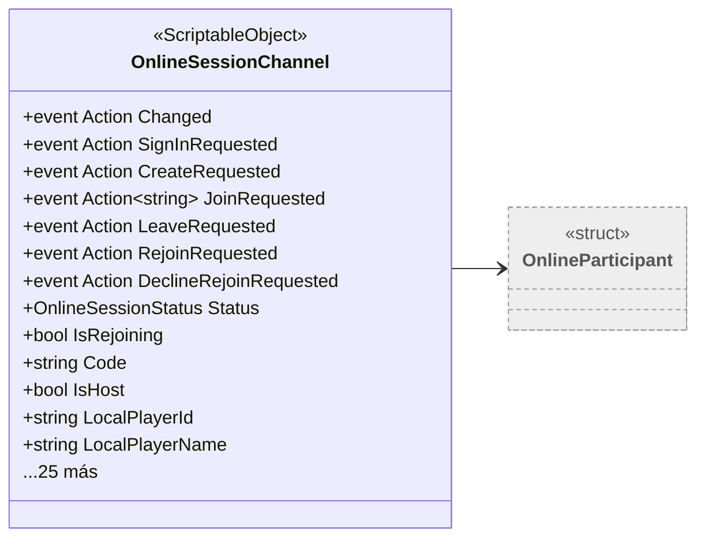

# OnlineSessionChannel

> Runtime channel between the online menu (requests, views) and the session service on the NetworkRoot (state). The menu only calls the Request* methods and reads the state; the service listens to the requests and is the only writer. Primitive data only, so it lives in the runtime assembly and the menu never references networking. Nothing is serialized: state from a previous play session is discarded through a generation counter.

**Módulo:** [[Modulo Data|Data]] · **Namespace:** `AlienFarms.Data` · **Archivo:** `Assets/Scripts/Data/OnlineSessionChannel.cs`

## Hereda / implementa
`ScriptableObject`

## Diagrama

## Usa
[[DisplayNameSanitizer]], [[OnlineParticipant]], [[OnlineSessionErrorKeys]], [[OnlineSessionStatus]], [[OnlineSessionStatusRules]], [[SessionCodeFormat]], [[Status]]

## Usado por
[[CloudSaveStatsService]], [[DevConnectionPanel]], [[LobbyStateSpawner]], [[MenuFlowController]], [[NetworkLobbyState]], [[OnlineMenuController]], [[OnlineSessionService]], [[OnlineSessionSfxPlayer]], [[PlayerStatsSync]], [[SessionExit]], [[Status]]
