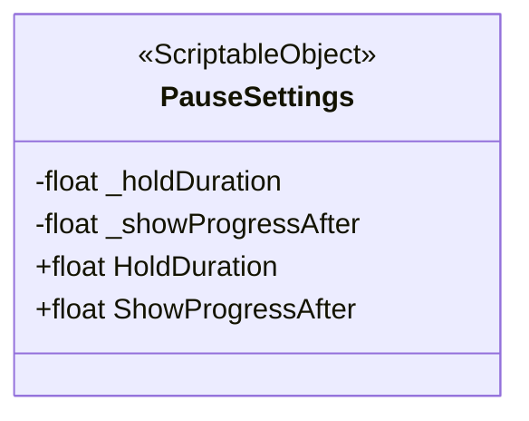

# PauseSettings

> Hold-to-pause tuning.

**Módulo:** [[Modulo Data|Data]] · **Namespace:** `AlienFarms.Data` · **Archivo:** `Assets/Scripts/Data/PauseSettings.cs`

## Hereda / implementa
`ScriptableObject`

## Diagrama

## Usado por
[[PauseHoldIndicatorView]], [[PlayerPauseInput]]
