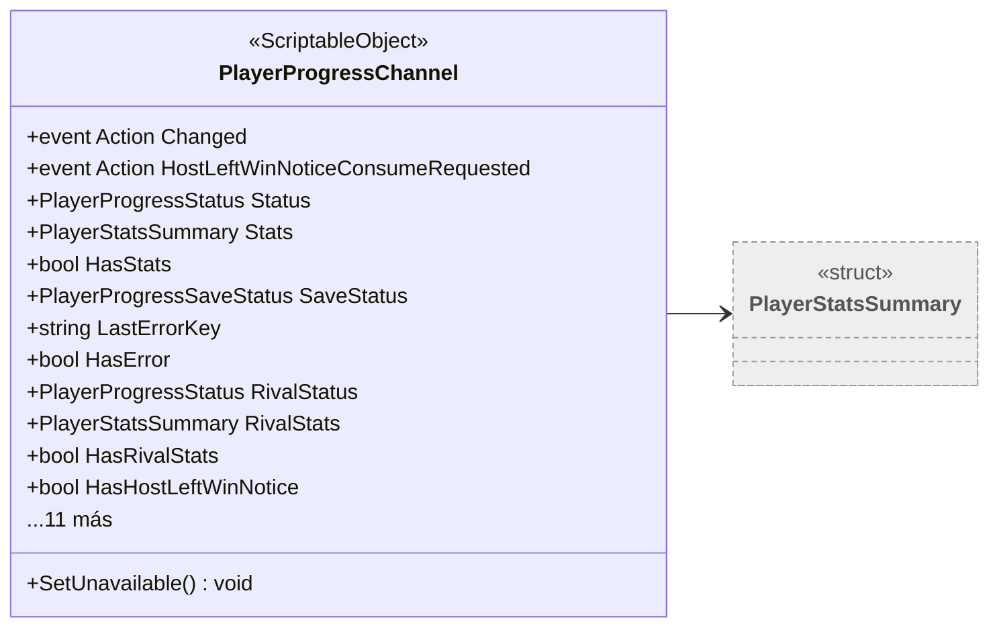

# PlayerProgressChannel

> Runtime channel with the local player's persistent progress (lifetime stats) and, in the online room, the rival's public stats. Views only read it; the cloud save service (task 2.8) is the only writer. Until then it stays `PlayerProgressStatus.Unavailable`. Nothing is serialized: state from a previous play session is discarded through a generation counter.

**Módulo:** [[Modulo Data|Data]] · **Namespace:** `AlienFarms.Data` · **Archivo:** `Assets/Scripts/Data/PlayerProgressChannel.cs`

## Hereda / implementa
`ScriptableObject`

## Diagrama

## Usa
[[PlayerProgressSaveStatus]], [[PlayerProgressStatus]], [[PlayerStatsSummary]], [[Status]]

## Usado por
[[CloudSaveStatsService]], [[OnlineMenuController]], [[PlayerStatsSync]], [[RivalStatsView]], [[SaveStatusBadgeView]], [[TitleStatsView]]
