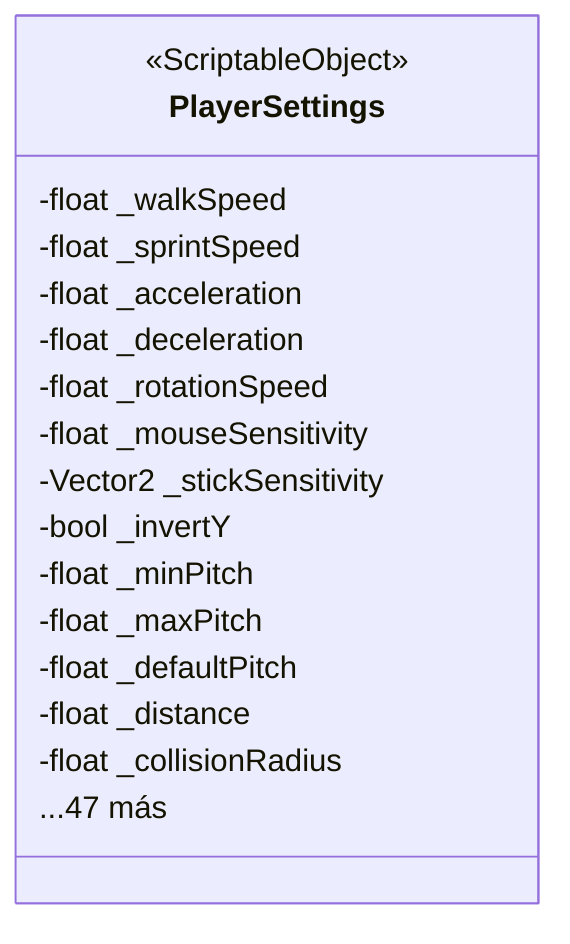

# PlayerSettings

> Tunable movement, camera, grab, aim and tackle values shared by player characters.

**Módulo:** [[Modulo Data|Data]] · **Namespace:** `AlienFarms.Data` · **Archivo:** `Assets/Scripts/Data/PlayerSettings.cs`

## Hereda / implementa
`ScriptableObject`

## Diagrama

## Usado por
[[PlayerGrabber]], [[PlayerMovement]], [[PlayerStunReceiver]], [[PlayerTackle]], [[ThirdPersonCamera]]
