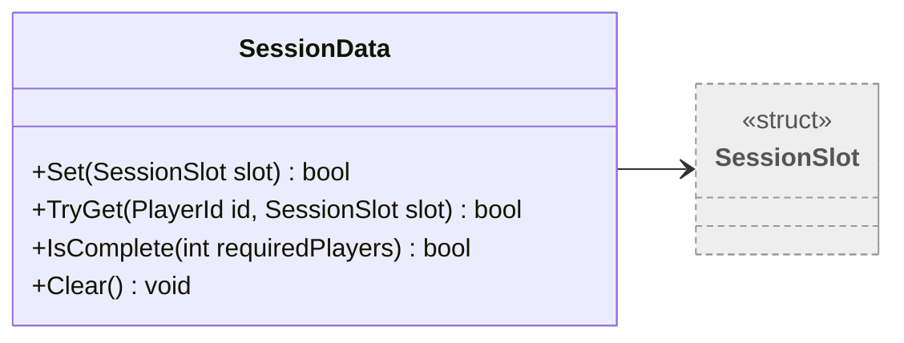

# SessionData

> Plain C# store of the players' pre-match choices, one `SessionSlot` per `PlayerId`.

**Módulo:** [[Modulo Data|Data]] · **Namespace:** `AlienFarms.Data` · **Archivo:** `Assets/Scripts/Data/SessionData.cs`

## Diagrama

## Usa
[[PlayerId]], [[SessionSlot]]

## Usado por
[[MatchSession]]
