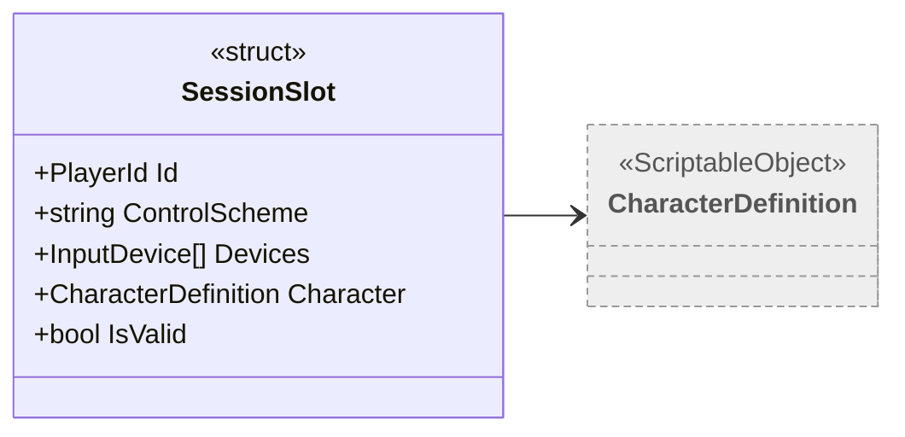

# SessionSlot

> What one player chose before the match: its control scheme, the devices it used (both keyboard and mouse for KeyboardMouse) and its character. Devices may be null or empty (the player then joins by pressing a button).

**Módulo:** [[Modulo Data|Data]] · **Namespace:** `AlienFarms.Data` · **Archivo:** `Assets/Scripts/Data/SessionSlot.cs`

## Diagrama

## Usa
[[CharacterDefinition]], [[PlayerId]]

## Usado por
[[MatchSession]], [[MenuFlowController]], [[PlayerJoinCoordinator]], [[SessionData]]
