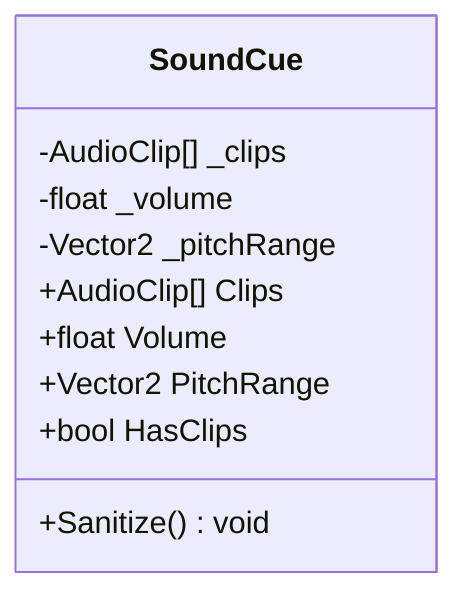

# SoundCue

> One sound effect: candidate clips (one picked at random), volume and random pitch range.

**Módulo:** [[Modulo Data|Data]] · **Namespace:** `AlienFarms.Data` · **Archivo:** `Assets/Scripts/Data/SoundCue.cs`

## Diagrama

## Usado por
[[AnimalData]], [[AudioVariation]], [[BombData]], [[BombSfxPlayer]]
