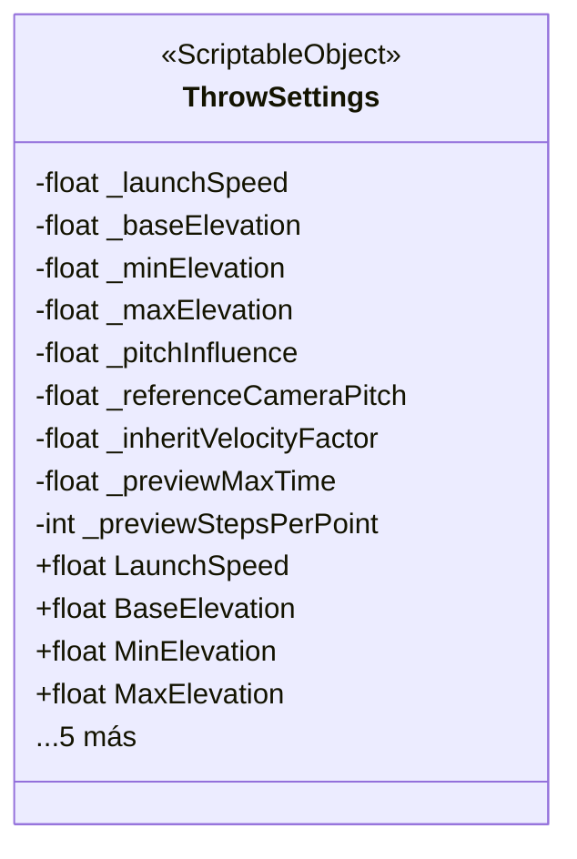

# ThrowSettings

> Launch and trajectory-preview tuning for thrown objects.

**Módulo:** [[Modulo Data|Data]] · **Namespace:** `AlienFarms.Data` · **Archivo:** `Assets/Scripts/Data/ThrowSettings.cs`

## Hereda / implementa
`ScriptableObject`

## Diagrama

## Usado por
[[Animal]], [[AnimalData]], [[Bomb]], [[BombData]], [[IThrowable]], [[PlayerAim]], [[ThrowTrajectoryView]]
