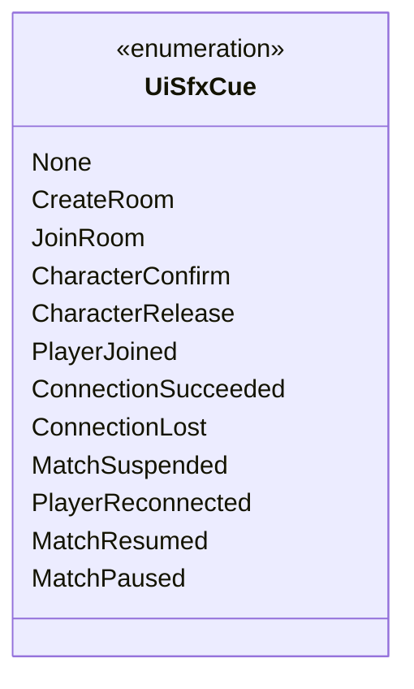

# UiSfxCue

**Módulo:** [[Modulo Data|Data]] · **Namespace:** `AlienFarms.Data` · **Archivo:** `Assets/Scripts/Data/UiSfxCue.cs`

## Diagrama

## Valores
`None`, `CreateRoom`, `JoinRoom`, `CharacterConfirm`, `CharacterRelease`, `PlayerJoined`, `ConnectionSucceeded`, `ConnectionLost`, `MatchSuspended`, `PlayerReconnected`, `MatchResumed`, `MatchPaused`

## Usado por
[[CharacterSelectSfxPlayer]], [[MatchConnectionCueTracker]], [[MatchStatusSfxPlayer]], [[OnlineLobbyCueRules]], [[OnlineSessionCueRules]], [[OnlineSessionSfxPlayer]], [[UiSfxLibrary]]
