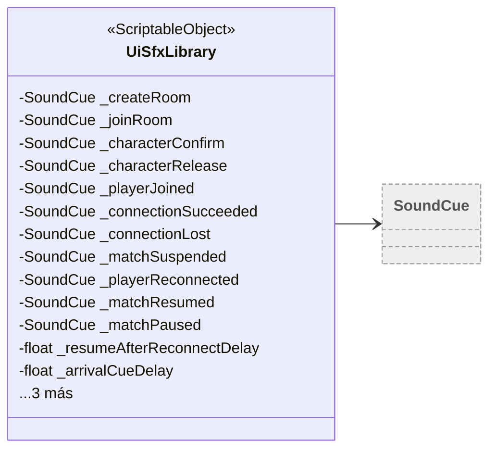

# UiSfxLibrary

**Módulo:** [[Modulo Data|Data]] · **Namespace:** `AlienFarms.Data` · **Archivo:** `Assets/Scripts/Data/UiSfxLibrary.cs`

## Hereda / implementa
`ScriptableObject`

## Diagrama

## Usa
[[SoundCue]], [[UiSfxCue]]

## Usado por
[[CharacterSelectSfxPlayer]], [[MatchStatusSfxPlayer]], [[OnlineSessionSfxPlayer]]
