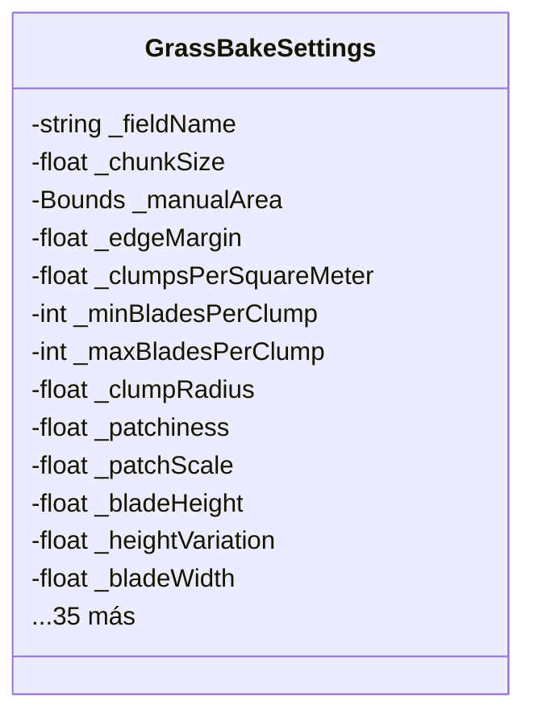

# GrassBakeSettings

> Authoring parameters for `GrassMeshBuilder`. Serialized by `GrassFieldBaker`.

**Módulo:** [[Modulo Editor|Editor]] · **Namespace:** `AlienFarms.Editor` · **Archivo:** `Assets/Scripts/Editor/GrassBakeSettings.cs`

## Diagrama

## Usado por
[[Buffers]], [[Chunk]], [[GrassFieldBaker]], [[GrassMeshBuilder]]
