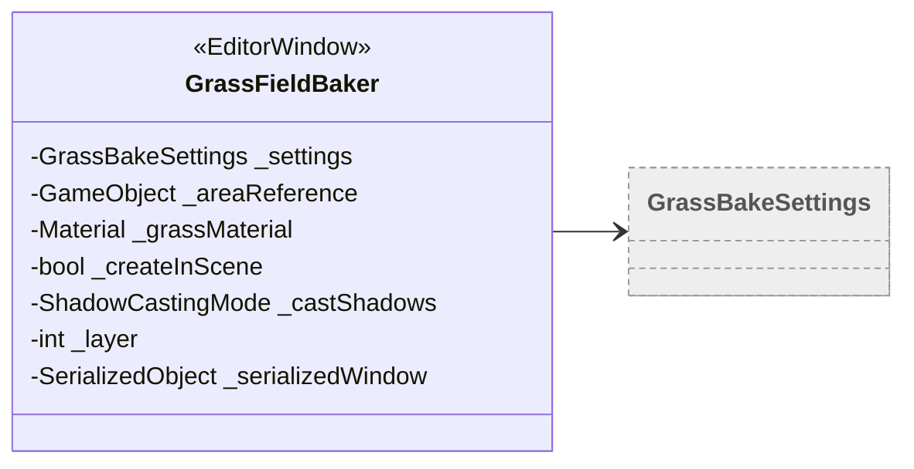

# GrassFieldBaker

> Authoring window: bakes a chunked grass-blade field into a mesh asset under Assets/Art/Models/Generated/ and optionally instantiates it in the scene under "Env_Grass".

**Módulo:** [[Modulo Editor|Editor]] · **Namespace:** `AlienFarms.Editor` · **Archivo:** `Assets/Scripts/Editor/GrassFieldBaker.cs`

## Hereda / implementa
`EditorWindow`

## Diagrama

## Usa
[[Chunk]], [[GrassBakeSettings]], [[GrassMeshBuilder]]
