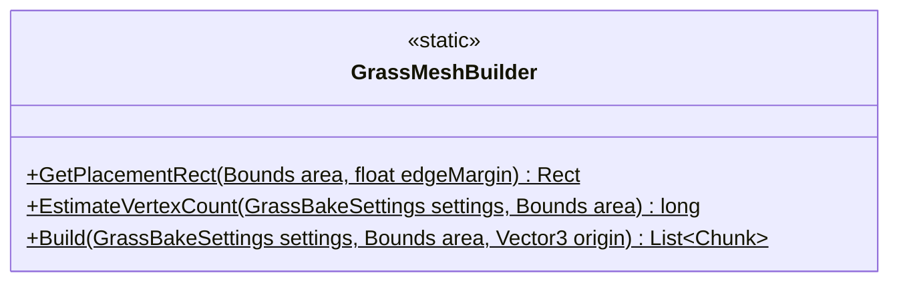

# GrassMeshBuilder

> Deterministically generates chunked grass-blade meshes for the AlienFarms/GrassBlades shader. Vertex layout: UV0 = (across, height 0..1), UV1 = blade root (mesh space), COLOR = (height, clump random, blade random, 1), NORMAL = blade facing biased up.

**Módulo:** [[Modulo Editor|Editor]] · **Namespace:** `AlienFarms.Editor` · **Archivo:** `Assets/Scripts/Editor/GrassMeshBuilder.cs`

## Diagrama

## Usa
[[GrassBakeSettings]]

## Usado por
[[GrassFieldBaker]]
